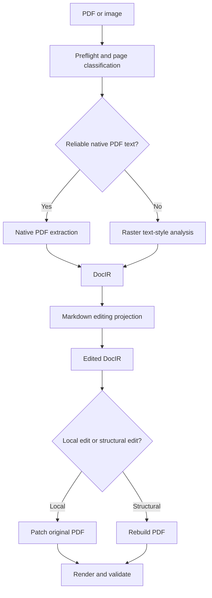
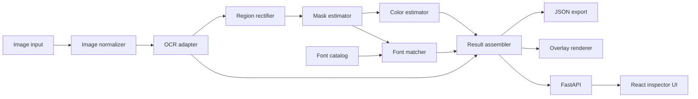

# DocStyle: Image Text Style Recovery and PDF Editing Foundation

> Codex-ready engineering plan
>
> Working name: `docstyle`
>
> Primary language: Python 3.13+
>
> Initial product: image-to-structured-text-style analyzer
>
> Long-term product: PDF -> DocIR/Markdown -> edited PDF workflow

---

## 0. How to use this document with Codex

Give Codex this repository and this file, then ask it to implement **one milestone at a time**. Do not ask it to build the whole product in one pass.

Recommended first prompt:

```text
Read docstyle_build_plan.md and AGENTS.md.
Implement milestone M0 only.
Do not start M1.
Run all required checks and tests.
At the end, report:
1. files changed,
2. commands run,
3. test results,
4. assumptions,
5. remaining M0 issues.
```

After reviewing M0, continue with:

```text
Implement milestone M1 from docstyle_build_plan.md only.
Preserve all public interfaces created in M0 unless the plan explicitly requires a change.
Run the complete test suite before finishing.
```

Apply the same pattern for each later milestone.

---

## 1. Product definition

### 1.1 Problem

Given an image containing printed text, the system should recover a structured approximation of:

- recognized text,
- text polygons and bounding boxes,
- reading order,
- text foreground color,
- local background color or background type,
- likely font family candidates,
- likely font weight and style,
- approximate font size in image pixels,
- approximate letter spacing and horizontal scale,
- debug artifacts that explain the result.

The output must be machine-readable and suitable for a later PDF editing pipeline.

### 1.2 Initial MVP

The first release accepts one raster image and returns:

1. OCR text regions.
2. A foreground text mask for each region.
3. Foreground and background color estimates.
4. Top-k font matches from a configured local font catalog.
6. An annotated preview image.
7. A versioned JSON result.
8. A CLI, HTTP API, and basic inspection UI.

### 1.3 Long-term product

The image analyzer becomes a component inside this document pipeline:



The first implementation must therefore use data contracts that can later fit into a document intermediate representation, called **DocIR**.

### 1.4 Explicit non-goals for the MVP

Do not attempt these in the first release:

- exact identification of fonts that are not in the configured catalog,
- exact recovery of a proprietary or custom-drawn typeface,
- treating handwriting as an exact font,
- editing PDFs,
- reconstructing complete page layout,
- recognizing tables, formulas, or diagrams as structured objects,
- training a new OCR or font model,
- cloud accounts, billing, teams, or multi-tenant storage,
- processing unbounded image sizes,
- claiming one exact font when evidence is weak.

For an unknown font, the correct result is a ranked list plus `unknown_or_out_of_catalog: true`.

---

## 2. Core design principles

1. **Structured output over screenshots**  
   Every stage must return typed data, not only visual overlays.

2. **Deterministic baseline before learned retrieval**  
   Build render-and-compare font matching first. Add FontCLIP or a custom embedding model only after the deterministic baseline is measurable.

4. **No forced answer**  
   The system must be allowed to return “no confident match.”

5. **Adapter boundaries around external models**  
   PaddleOCR-specific objects must never leak into public schemas.

6. **Debuggability**  
   Save crops, masks, candidate renderings, score breakdowns, and overlays when debug mode is enabled.

7. **Coordinate preservation**  
   All polygons use original-image coordinates. Derived crops also record the transformation matrix.

8. **Local-first and privacy-friendly**  
   The default pipeline runs locally. No image is sent to an external service unless a future adapter is explicitly enabled.

9. **Evaluation-driven development**  
   Build a synthetic ground-truth generator before optimizing algorithms.

10. **PDF-aware future compatibility**  
    Preserve provenance, source dimensions, color space, model versions, and transformations.

---

## 3. User stories

### 3.1 CLI user

```text
As a developer, I can run one command on an image and receive JSON,
an annotated image, region crops, masks, and font candidate previews.
```

### 3.2 API user

```text
As an application developer, I can upload an image to an HTTP endpoint
and receive a stable, versioned analysis response.
```

### 3.3 UI user

```text
As a user, I can upload an image, click a detected text region, inspect
recognized text, color swatches, font candidates, confidence, and warnings.
```

### 3.4 Correction workflow

```text
As a user, I can correct OCR text and rerun font matching for only that region.
```

### 3.5 Future PDF workflow

```text
As a PDF editor, I can attach the recovered text style and geometry to a DocIR
block, edit its Markdown projection, and either patch or rebuild the PDF.
```

---

## 4. Functional requirements

### FR-1: Image ingestion

The system shall:

- accept PNG, JPEG, WebP, and TIFF,
- reject unsupported or malformed files,
- apply EXIF orientation,
- normalize to sRGB,
- preserve alpha information,
- enforce configurable file-size and pixel-count limits,
- compute a SHA-256 input hash,
- record original dimensions and MIME type.

### FR-2: OCR

The system shall return, per text region:

- text,
- OCR confidence,
- polygon,
- axis-aligned bounding box,
- orientation if available,
- engine and model identifiers.

Use PaddleOCR behind an `OcrEngine` interface. Keep model names configurable rather than hard-coding one release.

### FR-3: Region rectification

For each text polygon, the system shall:

- add configurable context padding,
- rectify perspective when the polygon is quadrilateral,
- return the crop,
- return crop-to-source and source-to-crop transformations,
- preserve an unrectified context crop for background estimation.

### FR-4: Foreground/background segmentation

For each region, the system shall produce:

- a soft foreground alpha mask in `[0, 1]`,
- a hard foreground mask,
- a background mask,
- a segmentation confidence,
- the chosen segmentation method,
- warnings when the region is ambiguous.

### FR-5: Color estimation

For each region, the system shall estimate:

- primary foreground color in sRGB and CIELAB,
- optional secondary foreground colors,
- representative background color,
- background type: `solid`, `gradient`, `texture`, `image`, or `transparent`,
- color confidence,
- observed color variance,
- foreground/background contrast ratio.

### FR-6: Font catalog

The system shall:

- index TTF, OTF, and TTC files,
- calculate a stable file hash,
- extract family, subfamily, PostScript name, weight, width, italic flag, variation axes, and supported code points,
- avoid redistributing user fonts,
- store only metadata and local file references,
- support rebuilding the index.

### FR-7: Font matching

For each text region, the system shall:

- filter fonts by character coverage,
- render the recognized text with each candidate,
- optimize font size and simple geometric parameters,
- compare the rendered glyph mask with the observed mask,
- return a ranked top-k list,
- include a score breakdown,
- mark low-confidence or out-of-catalog cases.

### FR-8: Export

The system shall export:

- `result.json`,
- `annotated.png`,
- optional per-region crop and mask images,
- optional top candidate renderings,
- a machine-readable run manifest.

### FR-9: Correction and reranking

The API and UI shall allow the user to:

- replace OCR text for one region,
- rerun font matching without rerunning OCR for the whole image,
- preserve the original OCR text and the corrected text separately.

### FR-10: Reproducibility

Each result shall record:

- schema version,
- application version or Git commit,
- configuration snapshot,
- random seed,
- OCR model identifiers,
- font catalog version/hash,
- input hash,
- stage timings.

---

## 5. Quality attributes

### Correctness

- Never silently change coordinate systems.
- Never label a font as exact unless it is a verified closed-set match above a calibrated threshold.
- Never average anti-aliased edge pixels as if they were core text pixels.
- Preserve original OCR output even after a user correction.

### Reliability

- A failure in one region must not discard successful regions.
- Return partial results with region-level error objects.
- Model download and initialization failures must be explicit.

### Performance

- Cache font metadata and reusable render data.
- Batch OCR where supported.
- Use a two-stage font search so expensive rendering is limited to shortlisted fonts.
- Record cold-start and warm-run latency separately.

### Privacy

- Run locally by default.
- Do not write source images to permanent storage unless configured.
- Provide a run-retention setting.

### Maintainability

- Type all public Python functions.
- Keep algorithms in pure functions where practical.
- Put model-specific logic behind protocols/adapters.
- Use versioned Pydantic schemas.

---

## 6. Architecture



### 6.1 Components

#### `image_io`

Validates, decodes, orients, color-converts, hashes, and limits input.

#### `ocr`

Contains the `OcrEngine` protocol and PaddleOCR implementation.

#### `geometry`

Polygon normalization, rectification, coordinate transforms, padding, and clipping.

#### `segmentation`

Builds candidate text masks, scores them, and selects the best mask.

#### `color`

Estimates foreground/background models and color confidence.

#### `fonts.catalog`

Indexes fonts and character coverage.

#### `fonts.render`

Renders exact strings with font, size, features, direction, language, tracking, and transform parameters.

#### `fonts.match`

Candidate filtering, parameter optimization, scoring, ranking, and confidence calibration.

#### `schemas`

Versioned public data contracts.

#### `pipeline`

Orchestrates stages without embedding UI or HTTP concerns.

#### `artifacts`

Writes debug artifacts and manifests through a storage interface.

#### `api`

FastAPI routes and dependency wiring.

#### `web`

React/TypeScript inspection UI.

---

## 7. Recommended technology stack

### Backend

- Python 3.11+
- NumPy
- OpenCV headless
- Pillow with FreeType support
- fontTools
- SciPy
- scikit-image
- Pydantic
- PaddleOCR and PaddlePaddle through an optional dependency group
- FastAPI
- Uvicorn
- python-multipart

### Frontend

- React
- TypeScript
- Vite
- SVG overlay positioned above the source image
- A lightweight query/fetch layer; avoid a large state framework initially

### Tooling

- `uv` or another lockfile-producing Python package manager
- Ruff
- MyPy or Pyright
- Pytest
- Hypothesis for geometry and color property tests
- Vitest for frontend unit tests
- Playwright for one end-to-end UI smoke test
- Docker for Linux deployment

### Version policy

- Do not use floating unbounded dependencies in CI.
- Pin exact versions in a lockfile after the first successful platform smoke test.
- Keep PaddleOCR model names in configuration.
- Record the selected model names in every output manifest.
- Keep OCR optional so unit tests can run without downloading models.

---

## 8. Repository structure

```text
docstyle/
├── AGENTS.md
├── README.md
├── docstyle_build_plan.md
├── pyproject.toml
├── uv.lock
├── .env.example
├── .gitignore
├── Makefile
├── backend/
│   └── src/docstyle/
│       ├── __init__.py
│       ├── config.py
│       ├── logging.py
│       ├── schemas/
│       │   ├── common.py
│       │   ├── image.py
│       │   ├── ocr.py
│       │   ├── color.py
│       │   ├── font.py
│       │   └── result.py
│       ├── image_io/
│       │   ├── decode.py
│       │   └── normalize.py
│       ├── geometry/
│       │   ├── polygons.py
│       │   └── rectify.py
│       ├── ocr/
│       │   ├── base.py
│       │   ├── paddle.py
│       │   └── fake.py
│       ├── segmentation/
│       │   ├── candidates.py
│       │   ├── scoring.py
│       │   └── service.py
│       ├── color/
│       │   ├── spaces.py
│       │   ├── background.py
│       │   ├── foreground.py
│       │   └── service.py
│       ├── fonts/
│       │   ├── catalog.py
│       │   ├── metadata.py
│       │   ├── render.py
│       │   ├── metrics.py
│       │   ├── optimize.py
│       │   └── matcher.py
│       ├── pipeline/
│       │   ├── analyze.py
│       │   └── rerank.py
│       ├── artifacts/
│       │   ├── base.py
│       │   └── filesystem.py
│       ├── visualization/
│       │   └── overlay.py
│       ├── api/
│       │   ├── app.py
│       │   ├── dependencies.py
│       │   └── routes/
│       │       ├── analyze.py
│       │       ├── results.py
│       │       ├── fonts.py
│       │       └── health.py
│       └── cli.py
├── frontend/
│   ├── package.json
│   ├── vite.config.ts
│   ├── src/
│   │   ├── api/
│   │   ├── components/
│   │   ├── pages/
│   │   ├── types/
│   │   └── App.tsx
│   └── tests/
├── tests/
│   ├── unit/
│   ├── integration/
│   ├── fixtures/
│   └── golden/
├── scripts/
│   ├── build_font_catalog.py
│   ├── generate_synthetic_dataset.py
│   ├── evaluate.py
│   └── benchmark.py
├── data/
│   ├── fonts/.gitkeep
│   └── catalogs/.gitkeep
├── docs/
│   ├── architecture.md
│   ├── result-schema.md
│   ├── evaluation.md
│   └── pdf-integration.md
└── runs/.gitignore
```

---

## 9. Public data model

All API outputs must include `schema_version`. Use strict Pydantic models and reject unknown fields in internal stage contracts where practical.

### 9.1 Coordinate convention

- Image origin: top-left.
- X increases rightward.
- Y increases downward.
- Coordinates are floating-point pixels in the original decoded image.
- A polygon is ordered clockwise starting near the top-left point.
- Bounding box format: `[x_min, y_min, x_max, y_max]`.
- Normalized coordinates may be added later, but never replace pixel coordinates.

### 9.2 Example result

```json
{
  "schema_version": "1.0",
  "run_id": "01J...",
  "input": {
    "sha256": "...",
    "filename": "sample.png",
    "mime_type": "image/png",
    "width_px": 1600,
    "height_px": 900,
    "color_space": "sRGB"
  },
  "engine": {
    "app_version": "0.1.0",
    "git_commit": "...",
    "ocr_provider": "paddleocr",
    "ocr_models": {
      "detection": "configured-model-name",
      "recognition": "configured-model-name"
    },
    "font_catalog_id": "sha256:..."
  },
  "regions": [
    {
      "id": "region-0001",
      "polygon": [[125.0, 82.0], [511.0, 82.0], [511.0, 129.0], [125.0, 129.0]],
      "bbox": [125.0, 82.0, 511.0, 129.0],
      "ocr": {
        "original_text": "Quarterly Revenue",
        "corrected_text": null,
        "effective_text": "Quarterly Revenue",
        "confidence": 0.992
      },
      "segmentation": {
        "method": "lab_background_distance",
        "confidence": 0.94,
        "foreground_fraction": 0.18,
        "warnings": []
      },
      "style": {
        "foreground": {
          "srgb_hex": "#172238",
          "srgb": [23, 34, 56],
          "lab": [13.7, 1.1, -14.2],
          "confidence": 0.96,
          "delta_e_mad": 1.8
        },
        "background": {
          "type": "solid",
          "representative_srgb_hex": "#F7F3EA",
          "representative_srgb": [247, 243, 234],
          "confidence": 0.97,
          "variance": 2.1
        },
        "font": {
          "unknown_or_out_of_catalog": false,
          "estimated_size_px": 43.2,
          "estimated_tracking_px": -0.6,
          "estimated_horizontal_scale": 1.0,
          "weight_class": 600,
          "italic": false,
          "confidence": 0.84,
          "candidates": [
            {
              "font_id": "sha256:...#0",
              "family": "Inter",
              "subfamily": "Semi Bold",
              "postscript_name": "Inter-SemiBold",
              "score": 0.84,
              "score_breakdown": {
                "mask_iou": 0.88,
                "chamfer": 0.79,
                "edge_f1": 0.86,
                "width": 0.98
              },
              "parameters": {
                "size_px": 43.2,
                "tracking_px": -0.6,
                "horizontal_scale": 1.0
              }
            }
          ]
        }
      },
      "artifacts": {
        "crop": "artifacts/region-0001/crop.png",
        "foreground_mask": "artifacts/region-0001/foreground-mask.png",
        "background_mask": "artifacts/region-0001/background-mask.png",
        "candidate_previews": []
      },
      "warnings": []
    }
  ],
  "timings_ms": {
    "decode": 12.1,
    "ocr": 421.4,
    "segmentation": 36.7,
    "color": 8.5,
    "font_matching": 310.2,
    "total": 806.9
  },
  "warnings": []
}
```

### 9.3 Required internal interfaces

```python
from __future__ import annotations

from dataclasses import dataclass
from pathlib import Path
from typing import Protocol, Sequence

import numpy as np


@dataclass(frozen=True)
class OcrRegion:
    text: str
    confidence: float
    polygon_xy: np.ndarray  # shape: (N, 2), source-image coordinates


class OcrEngine(Protocol):
    def analyze(self, image_rgb: np.ndarray) -> Sequence[OcrRegion]: ...


class TextMaskEstimator(Protocol):
    def estimate(self, context_crop_rgb: np.ndarray) -> "MaskEstimate": ...


class ColorEstimator(Protocol):
    def estimate(
        self,
        crop_rgb: np.ndarray,
        foreground_alpha: np.ndarray,
    ) -> "ColorEstimate": ...


class FontMatcher(Protocol):
    def match(
        self,
        text: str,
        observed_alpha: np.ndarray,
        options: "FontMatchOptions",
    ) -> "FontMatchResult": ...
```

Do not import PaddleOCR, FastAPI, or frontend types into these protocols.

---

## 10. Pipeline design

## 10.1 Stage A: image validation and normalization

Steps:

1. Read uploaded bytes once.
2. Enforce maximum byte size before decode.
3. Decode with Pillow.
4. Apply EXIF orientation.
5. Reject images exceeding `max_pixels`.
6. Convert embedded profiles to sRGB when possible.
7. Preserve alpha as a separate channel.
8. Produce contiguous RGB `uint8` NumPy data.
9. Compute source hash and metadata.

Required tests:

- EXIF-rotated JPEG,
- RGBA PNG,
- grayscale image,
- CMYK JPEG,
- malformed image,
- decompression-bomb-sized dimensions,
- transparent text over transparent background.

## 10.2 Stage B: OCR

Use a PaddleOCR adapter, but map results immediately into `OcrRegion`.

Implementation requirements:

- `FakeOcrEngine` for tests.
- Lazy model initialization.
- Explicit model configuration.
- One engine instance reused across requests.
- Convert Paddle arrays to ordinary Python/NumPy values at the adapter boundary.
- Sort regions deterministically using a basic reading-order heuristic for the MVP.
- Return region errors without crashing the whole run.

Do not use a document VLM for font or color estimation. OCR only provides text and geometry here.

## 10.3 Stage C: polygon normalization and crop rectification

For each OCR polygon:

1. Validate finite coordinates.
2. Clip to source bounds.
3. Reject degenerate polygons.
4. Normalize point ordering.
5. Estimate orientation.
6. Expand a context polygon by a configurable number of pixels.
7. Build a perspective transform for quadrilaterals.
8. Save both:
   - tight rectified crop for mask/font matching,
   - padded context crop for background estimation.
9. Record 3x3 homography matrices.

For nearly horizontal rectangular text, avoid unnecessary resampling when a direct slice is sufficient.

## 10.4 Stage D: text-mask estimation

A single segmentation method will fail across all images. Generate multiple candidates and select the best.

### Candidate methods

1. **Local background color distance**
   - Estimate background from a border ring.
   - Convert image to Lab.
   - Compute per-pixel Delta E from the background estimate.
   - Threshold adaptively.

2. **Adaptive grayscale thresholding**
   - Run both dark-on-light and light-on-dark polarity.

3. **Color clustering**
   - Cluster crop pixels in Lab with `k` in a small range.
   - Treat clusters unlike the border/background as foreground candidates.

4. **Edge-supported fill**
   - Use edges and connected components to reject large background regions.

### Candidate cleanup

For every candidate:

- remove tiny connected components,
- fill small holes,
- apply minimal opening/closing,
- preserve anti-aliased edges in a soft alpha estimate,
- create an eroded core mask for foreground color sampling.

### Candidate scoring

Score masks using:

- plausible foreground occupancy,
- connected-component geometry,
- edge agreement,
- border leakage penalty,
- stroke-width consistency,
- agreement with OCR polygon dimensions,
- polarity plausibility,
- fragmentation penalty.

Save score details in debug mode.

### Failure behavior

If no mask is trustworthy:

- return the best candidate,
- set confidence low,
- add `ambiguous_text_mask`,
- lower font and foreground-color confidence.

## 10.5 Stage E: color estimation

### Foreground color

1. Use the eroded core foreground mask.
2. Convert pixels to Lab.
3. Remove extreme outliers.
4. Use a robust median or dominant cluster center.
5. Detect multi-color text when one cluster is insufficient.
6. Convert the estimate back to sRGB.
7. Report dispersion using median absolute Delta E.

Never estimate the text color by averaging the entire antialiased glyph boundary.

### Background color/model

1. Prefer pixels from the context ring outside the foreground mask.
2. Fit and compare these models:
   - constant color,
   - planar gradient in Lab,
   - clustered texture/palette.
3. Select the simplest model that explains the observed variance.
4. Return `image` or `texture` when a single color would be misleading.

### Contrast

Compute relative luminance and contrast ratio between representative foreground and background colors. This is diagnostic metadata, not proof that the original design meets an accessibility standard.

## 10.6 Stage F: font catalog

### Catalog inputs

Support one or more configured directories. The application must not silently scan the entire machine by default in server deployments.

### Indexed metadata

For each face or collection index:

- file hash,
- path,
- collection index,
- family,
- subfamily,
- PostScript name,
- typographic family/subfamily when present,
- weight class,
- width class,
- italic/oblique indicators,
- monospace flag when available,
- Unicode cmap coverage,
- variable font axes and named instances,
- license text or identifiers when discoverable,
- catalog build timestamp.

### Catalog ID

Calculate a deterministic hash over sorted font IDs and selected metadata. Put this ID in every analysis result.

### Font safety and licensing

- Do not commit arbitrary system or commercial font files.
- Use openly licensed fonts only for repository fixtures.
- Treat user font files as local data.
- Add a license-review note before distributing any bundled catalog.

## 10.7 Stage G: font matching baseline

Build this in two passes.

### Pass 1: cheap candidate filtering

Filter out fonts that:

- lack required code points,
- have grossly incompatible width metrics,
- have incompatible italic or monospace characteristics when those are confidently detected,
- cannot render the script correctly.

Optional early features:

- aspect ratio,
- average glyph width,
- cap-height/x-height estimates,
- edge-density descriptor,
- rough serif/sans classifier.

The cheap pass should reduce the catalog to a configurable shortlist.

### Pass 2: render-and-compare

For each shortlisted font:

1. Render the exact effective OCR text.
2. Use the correct direction and language when known.
3. Optimize:
   - pixel font size,
   - x/y placement,
   - tracking,
   - horizontal scale,
   - stroke dilation/erosion compensation,
   - selected variable-font axes where feasible.
4. Normalize observed and rendered masks to a common canvas.
5. Score the match.

### Initial score components

Use a weighted score built from:

- mask intersection-over-union,
- symmetric chamfer distance on edges,
- edge precision/recall or F1,
- rendered/observed width ratio,
- rendered/observed height ratio,
- projection-profile similarity,
- connected-component count agreement.

Do not include a neural embedding in the first matching milestone.

### Confidence

Font confidence must use more than the top score. Include:

- absolute top score,
- margin between first and second candidate,
- mask confidence,
- OCR confidence,
- text length and glyph diversity,
- whether diagnostic characters are present,
- whether the candidate is inside the known catalog.

Short strings like `I`, `1`, or `OK` must have low identification confidence even if the visual score is high.

### Unknown-font behavior

Set `unknown_or_out_of_catalog = true` when:

- the best score is below threshold,
- the best/second-best margin is too small,
- text is too short for discrimination,
- segmentation is poor,
- required glyphs were substituted.

## 10.8 Stage H: overlays and artifacts

Generate an annotated image showing:

- polygon,
- region ID,
- OCR text truncated for display,
- best font family or `unknown`,
- confidence.

In debug mode, save:

```text
runs/<run_id>/
├── input.png
├── result.json
├── manifest.json
├── annotated.png
└── regions/
    └── region-0001/
        ├── crop-tight.png
        ├── crop-context.png
        ├── mask-soft.png
        ├── mask-hard.png
        ├── mask-core.png
        ├── background-mask.png
        ├── segmentation-candidates/
        └── font-candidates/
```

Production retention may omit the input and intermediate artifacts.

---

## 11. Interfaces

## 11.1 CLI

Required commands:

```bash
# Analyze one image
python -m docstyle.cli analyze sample.png --out runs/sample

# Build or rebuild a font catalog
python -m docstyle.cli fonts index --font-dir ./data/fonts --out ./data/catalogs/local.json

# List indexed fonts
python -m docstyle.cli fonts list --catalog ./data/catalogs/local.json

# Rerank one region after corrected OCR text
python -m docstyle.cli rerank runs/sample/result.json region-0001 \
  --text "Quarterly Revenue"

# Generate synthetic benchmark data
python -m docstyle.cli dataset generate --config configs/synthetic.yaml

# Evaluate a result directory
python -m docstyle.cli evaluate data/eval-manifest.json
```

CLI rules:

- nonzero exit code for run-level failure,
- JSON logs optional,
- human-readable errors by default,
- `--debug` enables intermediate artifacts,
- `--seed` supported,
- `--no-ocr` accepts supplied fixture regions for deterministic testing.

## 11.2 HTTP API

### `POST /v1/analyze`

Multipart form fields:

- `file`: required image,
- `debug`: optional boolean,
- `top_k`: optional integer,
- `ocr_language`: optional string,
- `font_catalog_id`: optional string.

MVP may process synchronously. Introduce asynchronous jobs only after measuring real latency.

### `GET /v1/results/{run_id}`

Returns the complete result JSON.

### `GET /v1/results/{run_id}/artifacts/{path}`

Returns a permitted artifact. Prevent path traversal.

### `POST /v1/results/{run_id}/regions/{region_id}/rerank`

```json
{
  "corrected_text": "Quarterly Revenue",
  "top_k": 10
}
```

### `GET /v1/fonts`

Returns catalog summary and searchable metadata, never raw font bytes by default.

### `GET /health/live`

Process liveness only.

### `GET /health/ready`

Checks required configuration, catalog availability, and OCR initialization status.

### Error schema

```json
{
  "error": {
    "code": "IMAGE_TOO_LARGE",
    "message": "Decoded image exceeds the configured pixel limit.",
    "details": {},
    "request_id": "..."
  }
}
```

## 11.3 Web UI

MVP screen layout:

```text
+--------------------------------------------------------------+
| Upload / run options                                         |
+------------------------------+-------------------------------+
|                              | Selected region               |
| Image with SVG polygons      | OCR text + correction         |
|                              | Foreground/background swatches|
|                              | Segmentation confidence       |
|                              | Top font candidates           |
|                              | Candidate previews + scores   |
+------------------------------+-------------------------------+
| Run metadata, warnings, export JSON                          |
+--------------------------------------------------------------+
```

Required UI behavior:

- preserve image aspect ratio,
- scale SVG polygons correctly,
- region hover and selection,
- keyboard navigation through regions,
- show confidence without implying false precision,
- show “unknown/out of catalog” clearly,
- allow OCR correction and reranking,
- download JSON and annotated image,
- display stage errors and partial results.

---

## 12. Milestone plan

Each milestone is independently reviewable. Codex must not begin the next milestone until the current milestone tests pass.

## M0 - Repository, contracts, and engineering guardrails

### Goal

Create a clean, testable skeleton with public schemas and no model downloads.

### Tasks

- Create repository structure.
- Add `AGENTS.md` using the rules in section 18.
- Configure package management and lockfile.
- Add Ruff, type checking, and Pytest.
- Implement configuration models.
- Implement the public Pydantic schemas.
- Implement structured error types.
- Add `FakeOcrEngine` and pipeline dependency interfaces.
- Add a minimal CLI `--help`.
- Add CI for lint, type check, and unit tests.

### Acceptance criteria

- `ruff check .` passes.
- formatter check passes.
- type check passes for backend source.
- `pytest` passes without OCR dependencies installed.
- schemas serialize deterministically.
- an example result validates against the schema.
- no network access is required by tests.

## M1 - Synthetic dataset generator

### Goal

Create controlled ground-truth images before implementing inference algorithms.

### Tasks

- Index a small fixture font set with redistribution-compatible licenses.
- Generate images with known:
  - text,
  - font ID,
  - size,
  - tracking,
  - foreground color,
  - background color,
  - polygon,
  - blur/noise/perspective settings.
- Support solid, gradient, and lightly textured backgrounds.
- Add degradations:
  - JPEG compression,
  - Gaussian blur,
  - rescaling,
  - rotation,
  - perspective,
  - shadow,
  - low contrast,
  - antialiasing.
- Save ground-truth JSON.
- Make generation deterministic by seed.

### Acceptance criteria

- Same seed produces byte-identical metadata and equivalent image output.
- Generated polygon encloses rendered text.
- Every generated sample includes font and color truth.
- At least 100 small samples can be generated in one command.
- Unit tests verify geometry and metadata.

## M2 - Image ingestion, geometry, and OCR adapter

### Goal

Produce stable OCR regions in source-image coordinates.

### Tasks

- Implement image validation/normalization.
- Implement polygon utilities and rectification.
- Implement PaddleOCR adapter as an optional dependency.
- Map OCR output to public/internal schemas.
- Implement deterministic reading-order sorting.
- Add one real OCR integration smoke test marked separately.
- Keep normal CI independent of model downloads.

### Acceptance criteria

- Synthetic fixture regions can be processed with `FakeOcrEngine`.
- Optional Paddle smoke test returns text and polygons for a fixture.
- EXIF and color-mode fixtures pass.
- Coordinate round-trip error through homography is within a documented tolerance.
- Degenerate polygons return typed errors.

## M3 - Text mask and color extraction

### Goal

Recover foreground and background colors on controlled images.

### Tasks

- Implement segmentation candidate generators.
- Implement candidate scoring and selection.
- Produce hard, soft, and core masks.
- Implement Lab conversions and Delta E utilities.
- Implement robust foreground color estimation.
- Implement solid/gradient/texture background classification.
- Add debug artifact output.

### Acceptance criteria

On the clean synthetic validation subset:

- median foreground Delta E 2000 is at or below 3,
- median solid-background Delta E 2000 is at or below 3,
- median hard-mask IoU is at or above 0.85,
- ambiguous cases produce warnings rather than exceptions.

Thresholds may be revised only with an evaluation report explaining why.

## M4 - Font catalog and renderer

### Goal

Create a trustworthy font inventory and exact-string renderer.

### Tasks

- Parse TTF, OTF, and TTC metadata with fontTools.
- Extract cmap coverage.
- Support collection face indices.
- Record variable axes and named instances.
- Create deterministic catalog serialization and catalog ID.
- Render text masks with Pillow/FreeType.
- Support language, direction, and OpenType features where available.
- Add size and tracking controls.
- Add a render cache.

### Acceptance criteria

- Catalog build is deterministic.
- Corrupt fonts are skipped with warnings.
- Rendered masks have stable dimensions.
- Character coverage filtering is correct on fixtures.
- TTC faces receive distinct IDs.
- No fixture depends on unlicensed system fonts.

## M5 - Font matching baseline

### Goal

Rank the correct font highly on a closed synthetic catalog.

### Tasks

- Implement cheap candidate filtering.
- Implement mask normalization.
- Implement IoU, chamfer, edge F1, projection, and dimension scores.
- Implement size, tracking, x-position, and scale optimization.
- Implement weighted ranking.
- Implement confidence and out-of-catalog logic.
- Save top candidate renderings in debug mode.

### Acceptance criteria

On the clean closed-set synthetic subset:

- top-1 font-face accuracy target: at least 80%,
- top-5 font-face accuracy target: at least 95%,
- median estimated size error target: at most 1.5 px,
- unknown-font samples are not forced into high-confidence exact matches.

Track performance separately for strings under 4 characters; do not combine them with longer-text metrics.

## M6 - End-to-end CLI

### Goal

Analyze an image from one command and produce complete artifacts.

### Tasks

- Implement pipeline orchestration.
- Implement run IDs and manifests.
- Implement filesystem artifact store.
- Implement annotated overlay.
- Implement `analyze`, `fonts`, `rerank`, and `evaluate` commands.
- Add stage timings.
- Add partial region failure handling.

### Acceptance criteria

- One CLI command creates a valid `result.json` and `annotated.png`.
- Reranking one corrected region does not rerun OCR.
- A failed region appears as a region error while other regions remain available.
- Repeated runs with the same deterministic inputs/config produce equivalent JSON apart from allowed timestamps and run IDs.

## M7 - FastAPI service

### Goal

Expose the engine through a stable local HTTP API.

### Tasks

- Implement upload limits and MIME validation.
- Implement analysis, result, artifact, rerank, font, and health routes.
- Add request IDs and structured errors.
- Reuse a single OCR service instance.
- Protect artifact paths.
- Add OpenAPI examples.
- Add API integration tests.

### Acceptance criteria

- API tests run with fake OCR.
- Multipart upload works.
- Oversized and malformed images return correct error codes.
- Path traversal attempts fail.
- OpenAPI schema is generated and committed or snapshot-tested.

## M8 - React inspection UI

### Goal

Make results understandable and correctable by a human.

### Tasks

- Implement upload and run options.
- Draw polygons in an SVG overlay.
- Add region list and region detail panel.
- Show foreground/background swatches and numeric values.
- Show font candidate previews and score breakdowns.
- Add OCR correction and rerank.
- Add JSON and annotated-image export.
- Add loading, empty, error, and partial-result states.

### Acceptance criteria

- Polygon selection remains accurate under resize.
- A corrected string triggers only region reranking.
- UI visibly distinguishes exact/strong candidate from uncertain/unknown.
- Vitest tests pass.
- One Playwright happy-path test passes against fake OCR.

## M9 - Evaluation, calibration, performance, and hardening

### Goal

Turn a demo into a measurable engineering system.

### Tasks

- Create train/dev/test splits for synthetic data.
- Create a small manually annotated real-world set.
- Add evaluation reports by difficulty bucket.
- Calibrate confidence thresholds.
- Benchmark cold/warm CPU and GPU runs.
- Profile font rendering and add caches/indexes.
- Add resource limits, timeouts, and cancellation checks.
- Add malformed-image and corrupt-font fuzz tests.
- Add privacy and retention configuration.

### Acceptance criteria

- `evaluate.py` produces JSON and Markdown reports.
- Metrics are broken down by text length, contrast, blur, perspective, background type, and catalog status.
- Confidence reliability is measured, not assumed.
- Warm-run benchmarks are reproducible on a named test machine.
- No critical path performs unbounded work.

## M10 - PDF ingestion and DocIR compatibility

### Goal

Use the image analyzer selectively inside a PDF-to-DocIR pipeline.

### Tasks

- Add PDF preflight and page rendering.
- Detect reliable native text.
- Extract native PDF text spans, font metadata, colors, and geometry when available.
- Run raster style recovery only for scanned or flattened regions.
- Define versioned DocIR `Document`, `Page`, and `Block` models.
- Map image analyzer regions into DocIR text blocks.
- Export a Markdown projection plus a source map.
- Preserve the original PDF as immutable input.

### Acceptance criteria

- Native PDF text is not unnecessarily OCRed.
- Scanned pages produce image-derived blocks.
- Every Markdown block maps back to a DocIR block ID.
- Every block records provenance: native, OCR, corrected, or inferred.

## M11 - PDF editing and regeneration

### Goal

Support the first controlled edit workflows.

### Tasks

- Classify changes as local patch or structural rebuild.
- Implement local text replacement for bounded cases.
- Use real redaction/removal rather than drawing a white rectangle.
- Implement HTML/CSS or DOCX-based rebuild for structural edits.
- Render output PDF pages to images.
- Compare expected versus unexpected visual changes.
- Re-extract output text for semantic validation.

### Acceptance criteria

- Local edits change only expected regions within tolerance.
- Structural rebuilds contain all edited semantic content.
- No clipped text, missing glyphs, or unexpected blank pages in test fixtures.
- The original PDF is never overwritten.

## M12 - Advanced font retrieval and production scaling

### Goal

Improve large-catalog search and real-world robustness.

Potential work:

- evaluate FontCLIP as a retrieval plugin after license review,
- train a custom embedding model on synthetic crops from the exact production catalog,
- add approximate-nearest-neighbor search,
- detect font categories and typographic attributes,
- support variable-font axis optimization,
- add multilingual shaping and vertical text,
- support multi-color/gradient text,
- add queue workers and object storage only when usage requires them.

This milestone must be driven by measured failure modes from M9, not by novelty.

---

## 13. Evaluation plan

### 13.1 Dataset buckets

Evaluate separately on:

- clean synthetic,
- compressed synthetic,
- blurred synthetic,
- low-contrast synthetic,
- perspective synthetic,
- gradient background,
- textured background,
- out-of-catalog fonts,
- short strings,
- digits and identifiers,
- real screenshots,
- camera photographs,
- scanned documents.

### 13.2 OCR metrics

- character error rate,
- word error rate,
- exact-string accuracy,
- polygon IoU where ground truth exists.

### 13.3 Mask metrics

- hard-mask IoU,
- Dice coefficient,
- boundary F1,
- foreground occupancy error.

### 13.4 Color metrics

- Delta E 2000 for foreground,
- Delta E 2000 for solid background,
- background-type classification accuracy,
- confidence versus observed error.

### 13.5 Font metrics

- top-1 family accuracy,
- top-1 face accuracy,
- top-5 family accuracy,
- top-5 face accuracy,
- mean reciprocal rank,
- out-of-catalog detection precision/recall,
- size error in pixels,
- tracking error in pixels,
- confidence calibration.

### 13.6 System metrics

- cold-start latency,
- warm-run latency,
- OCR latency,
- per-region segmentation latency,
- per-region font matching latency,
- peak memory,
- cache hit rate,
- partial failure rate.

### 13.7 Golden tests

Maintain a small golden set with reviewed:

- result JSON,
- masks,
- overlays,
- font rankings.

Golden updates require an explicit test flag and a human-readable diff report.

---

## 14. Test strategy

### Unit tests

Test pure functions for:

- coordinate transforms,
- polygon ordering,
- crop padding,
- color conversions,
- Delta E calculations,
- mask morphology,
- connected-component filtering,
- font metadata extraction,
- cmap coverage,
- rendering dimensions,
- scoring metrics,
- confidence rules.

### Property tests

Use Hypothesis for:

- homography round trips,
- polygons clipped to bounds,
- color conversion ranges,
- deterministic catalog hashes,
- no negative dimensions,
- result schemas always serializable.

### Integration tests

- fake OCR -> full pipeline,
- one optional PaddleOCR smoke test,
- font index -> render -> match,
- API multipart upload,
- API rerank,
- artifact access control.

### UI tests

- polygon scaling math,
- selected-region state,
- OCR correction submission,
- uncertain result rendering,
- one full upload-to-result smoke flow.

### Failure tests

- invalid image,
- huge dimensions,
- empty OCR result,
- zero-area polygon,
- all-transparent crop,
- identical foreground/background,
- unsupported glyphs,
- corrupt font,
- font with missing metadata,
- OCR model unavailable,
- artifact disk full or unwritable.

---

## 15. Security and privacy

### Input security

- limit upload bytes,
- limit decoded pixels,
- limit image dimensions,
- disable unrestricted filesystem paths,
- use random run directories,
- sanitize original filenames,
- prevent ZIP/archive input in the MVP,
- add stage timeouts,
- isolate production model workers where feasible.

### Artifact security

- artifact route must resolve paths under a run root,
- never concatenate user input into a filesystem path,
- use allowlisted artifact names or safe resolved paths,
- configure retention and cleanup,
- do not expose local font file paths to remote clients.

### Font security

Fonts are complex binary inputs. Treat user-supplied fonts as untrusted:

- enforce file-size limits,
- parse in an isolated worker in production,
- catch parser failures,
- hash and deduplicate,
- never execute font-provided code,
- keep a denylist/quarantine mechanism for crashing files.

### Privacy

- default to local processing,
- no analytics by default,
- no external font API by default,
- document exactly which artifacts are stored,
- support immediate run deletion.

---

## 16. Observability

Use structured logs with:

- request ID,
- run ID,
- input hash prefix,
- stage name,
- region ID,
- duration,
- model/catalog identifiers,
- warning/error code.

Do not log full recognized text by default in production because it may contain sensitive content.

Expose optional metrics:

- request count,
- stage latency histograms,
- OCR failures,
- no-font-match rate,
- cache hit rate,
- active runs,
- retained artifact bytes.

---

## 17. Performance strategy

### Start simple

Measure before adding queues, GPUs, vector databases, or distributed workers.

### Required optimizations

- reuse OCR model instances,
- memory-map or cache the font catalog,
- cache rendered text for repeated `(font, text, size, options)` keys,
- shortlist before expensive matching,
- downsample only for OCR detection when source geometry can be mapped back safely,
- process independent regions concurrently with a bounded worker pool,
- cap candidate count and optimizer iterations.

### Avoid premature architecture

Do not add Redis, Celery, Kubernetes, or object storage during the MVP unless a measured requirement demands them.

---

## 18. `AGENTS.md` instructions for Codex

Create an `AGENTS.md` containing at least the following:

```markdown
# Repository instructions

## Development workflow

- Read `docstyle_build_plan.md` before changing architecture.
- Implement only the requested milestone.
- Do not begin a later milestone implicitly.
- Preserve public schemas unless the active milestone requires a versioned change.
- Keep external model/framework objects behind adapters.
- Do not add network-dependent unit tests.
- Do not download OCR models during ordinary test runs.
- Use deterministic seeds in tests and data generation.
- Add or update tests for every behavior change.
- Run lint, format check, type check, and tests before completion.

## Code quality

- Use type hints on public and internal service interfaces.
- Prefer small pure functions for image/geometry/math operations.
- Use structured errors with stable error codes.
- Do not swallow exceptions without adding context.
- Do not log source images or full OCR text by default.
- Avoid hidden global mutable state.
- Document coordinate systems and array shapes.

## Dependencies

- Prefer existing dependencies over adding new ones.
- Explain any new dependency in the final report.
- Keep OCR and GPU dependencies optional.
- Do not bundle or commit fonts without verified redistribution rights.

## Completion report

At the end of each task, report:

1. files changed,
2. design decisions,
3. commands run,
4. test results,
5. known limitations,
6. exact next milestone, without implementing it.
```

---

## 19. Risks and mitigations

| Risk | Consequence | Mitigation |
|---|---|---|
| OCR text is wrong | Font rendering compares the wrong glyphs | Preserve OCR confidence, allow correction, rerank locally |
| Very short text | Many fonts are visually indistinguishable | Lower confidence; require more text; return top-k |
| Font is not in catalog | False exact match | Unknown/out-of-catalog classifier and score threshold |
| Anti-aliasing contaminates color | Text color looks too light | Use eroded core mask and Lab robust statistics |
| Text sits on an image | No single background color exists | Background type model and low-confidence representative color |
| Shadows/outlines | Mask and color become multi-layered | Detect secondary components; add warning; later model effects separately |
| Perspective/blur | Font ranking degrades | Rectification, degradation-aware synthetic data, confidence reduction |
| Variable fonts | Static face metadata is insufficient | Record axes; optimize selected axes in a later milestone |
| Complex scripts | Incorrect shaping | Use proper shaping engine and script/language metadata |
| Font licensing | Cannot redistribute catalog | Store metadata only; bundle only reviewed open fonts |
| Paddle dependency changes | Integration breaks | Adapter boundary, pinned lockfile, smoke test |
| Huge catalog is slow | Excessive candidate rendering | Two-stage retrieval, caches, later embedding index |
| Confidence appears authoritative | User overtrusts uncertain result | Explicit unknown state, warnings, score breakdown |

---

## 20. Definition of done for the image analyzer

The image analyzer is ready for controlled use when:

- a user can upload an image through the UI,
- text regions are selectable and mapped correctly,
- each region shows OCR text, masks, colors, font candidates, confidence, and warnings,
- corrected text can be reranked without full reanalysis,
- JSON output validates against a versioned schema,
- the synthetic benchmark meets documented thresholds,
- real-world benchmark results and failure buckets are published,
- unknown fonts are not forced into exact matches,
- source images remain local by default,
- lint, type checks, unit tests, integration tests, and one UI E2E test pass,
- dependency and model versions are reproducible.

---

## 21. Suggested Codex prompt sequence

### Prompt 1 - M0

```text
Read docstyle_build_plan.md in full.
Implement M0 only: repository, contracts, and engineering guardrails.
Create AGENTS.md from section 18.
Use fake OCR only; do not install or initialize PaddleOCR yet.
Run lint, formatting check, type checking, and tests.
Do not start M1.
```

### Prompt 2 - M1

```text
Implement M1 only.
Build a deterministic synthetic dataset generator with licensed fixture fonts,
ground-truth polygons, colors, font IDs, size, tracking, and degradations.
Add tests for determinism and geometry.
Do not implement inference yet.
```

### Prompt 3 - M2

```text
Implement M2 only.
Add image normalization, polygon geometry, crop rectification, and the optional
PaddleOCR adapter. Keep ordinary CI model-free. Add a separately marked OCR
smoke test. Do not implement segmentation or font matching.
```

### Prompt 4 - M3

```text
Implement M3 only.
Add multi-candidate text-mask estimation, mask scoring, foreground/background
color estimation, debug artifacts, and evaluation against M1 ground truth.
Do not add font matching.
```

### Prompt 5 - M4

```text
Implement M4 only.
Build the font catalog and exact-string renderer. Support TTF, OTF, TTC,
character coverage, deterministic IDs, and fixture tests. Do not implement
font ranking yet.
```

### Prompt 6 - M5

```text
Implement M5 only.
Build deterministic render-and-compare font matching, optimization, ranking,
confidence, and unknown-font behavior. Produce an evaluation report on the
synthetic test split.
```

### Prompt 7 - M6

```text
Implement M6 only.
Wire the existing stages into an end-to-end CLI with manifests, JSON output,
overlays, debug artifacts, reranking, timings, and partial failure handling.
```

### Prompt 8 - M7

```text
Implement M7 only.
Expose the engine with FastAPI, stable errors, upload limits, artifact safety,
health checks, OpenAPI examples, and integration tests using fake OCR.
```

### Prompt 9 - M8

```text
Implement M8 only.
Build the React/TypeScript inspection UI with SVG polygons, region details,
color swatches, font previews, confidence, warnings, OCR correction, reranking,
and exports. Add unit tests and one Playwright smoke test.
```

### Prompt 10 - M9

```text
Implement M9 only.
Add evaluation splits, real-image annotation format, confidence calibration,
benchmarking, profiling, resource limits, retention settings, and hardening.
Publish machine-readable and Markdown evaluation reports.
```

---

## 22. Reference implementation notes

- PaddleOCR should be used through its documented Python pipeline, which returns recognized text, confidence scores, and polygons/boxes. Keep its exact model selection configurable.
- OpenCV provides the image-processing primitives needed for morphology, perspective transforms, connected components, and clustering.
- Pillow uses FreeType for TrueType/OpenType rendering and exposes text bounds and lengths needed for candidate rendering.
- fontTools provides font metadata, cmap coverage, collection support, glyph access, and variation data.
- FastAPI supports multipart file uploads through `UploadFile` and should be isolated from core pipeline contracts.
- FontCLIP is a possible later retrieval component, not an MVP dependency. Review all relevant licenses before production use.

### Primary references

- PaddleOCR OCR pipeline: <https://www.paddleocr.ai/latest/en/version3.x/pipeline_usage/OCR.html>
- PaddleOCR repository: <https://github.com/PaddlePaddle/PaddleOCR>
- OpenCV k-means/color quantization: <https://docs.opencv.org/4.1.0/d1/d5c/tutorial_py_kmeans_opencv.html>
- Pillow ImageFont: <https://pillow.readthedocs.io/en/stable/reference/ImageFont.html>
- fontTools ttLib: <https://fonttools.readthedocs.io/en/latest/ttLib/>
- FastAPI file uploads: <https://fastapi.tiangolo.com/tutorial/request-files/>
- FontCLIP reference implementation: <https://github.com/yukistavailable/FontCLIP>

---

## 23. Immediate next action

Start with **M0**, review its generated schemas and repository boundaries, and only then generate the synthetic dataset in M1. The synthetic benchmark is the foundation for deciding whether every later algorithm actually improves the system.
