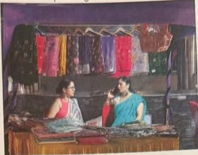
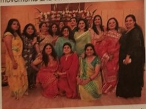
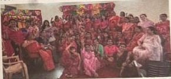
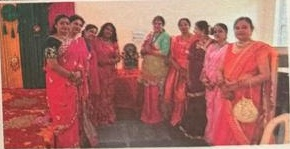

# Joy and Togetherness at Teej Sakhi Celebration

by Dr Manu Bedi (Alexandra C 003, Grand Omaxe, Sector 93B)

The Teej Sakhi Celebration at Grand Omaxe was a vibrant and heartwarming event that brought residents, families, and friends together to celebrate the spirit of Teej. The occasion was filled with cultural charm, festive shopping, delicious food, and exciting entertainment, creating beautiful memories for everyone who attended.

The event featured attractive stalls showcasing a stunning collection of green bangles, a traditional symbol of Teej. Visitors enthusiastically explored the various designs and styles, adding a festive touch to their celebrations. Alongside these, festive clothing stalls displayed elegant ethnic wear, including sareens, lehengas, kurtis, and accessories, giving attendees an opportunity to shop for traditional outfits and festive essentials.

A variety of food stalls served delicious snacks and refreshments, delighting guests with flavors that added to the festive atmosphere. Children enjoyed themselves in the

dedicated gaming zone, participating in fun activities and games throughout the evening.

One of the highlights of the celebration was the captivating Radha-Krishna dance

performance, which beautifully reflected Indian culture, devotion, and artistic expression. The event also encouraged community participation through group performances, allowing residents to showcase their talents and celebrate together.

Adding to the excitement, complimentary mehndi and glitter art were offered to selected participants, making the occasion even more

# Beautiful Teej Evening In The Forest Spa

by Cultural Committee and TFSAOA

Teeji was celebrated in style with a beautiful and vibrant evening filled with colour, music, laughter and togetherness, at The Forest Spa. The graceful Ghoomar dancers added a magical touch, bringing the traditional spirit of Teeji alive with their elegant movements and colourful attire.

The evening was made even more exciting with fun-filled events that created an atmosphere of anticipation and cheerful moments:

Teej Tambola: A fun Teej-themed Tambo-

la was organized, where everyone participated

enthusiastically and enjoyed the game.

Teej Song Game: Each team was given a Teej-related word, and they had to sing a song containing that word. It was a fun and entertaining activity enjoyed by all.

No Teej Queen this time as we wanted all of them to feel special.

Teej Picture Game: A picture-based game related to Teej was also organized, in which everyone took part and had lots of fun.

At the end there were 5 lucky dips; and that was an exciting moment for all the ladies. On their arrival, all were welcomed with rose petals, teeka, roli and ittar; each one of them was given slips of their names that were put in a bowl at the entrance, which were the lucky draws.

Guests enjoyed a sumptuous spread of Dilli chaat and delicious snacks, followed by lively music, dance and entertaining games.

It was a wonderful celebration of tradition, friendship and community — a truly memorable Teej evening filled with joy, laughter and festive spirit!

special and colorful. The mascot entertainment attracted children and families, creating cheerful moments and memorable photo opportunities.

The Teej Sakhi Celebration successfully fostered a sense of community, tradition, and togetherness among all attendees. The evening was filled with music, laughter, cultural performances, shopping, and festive enjoyment, making it a truly memorable occasion for everyone present at Grand Omaxe.

## Teej Celebration in Sector 92

by Dr. Shraddha Vashisth (Executive Member; B-394, Sector 92)

The Teeji festival was celebrated with great enthusiasm, joy, and traditional spirit in Sector 92, Noida. The event was beautifully organised by the Mahila

Samiti, Sector 92, with the support and cooperation of RWA Sector 92.

The celebration brought together women residents in a vibrant atmosphere filled with

traditional rituals, cultural activities, music, dance, and festive cheer. The beautifully decorated venue and active participation of the residents made the occasion truly memorable.

The valuable guidance and encouragement of our respected RWA President, Rahul Sharma Ji, added to the success and grandeur of the celebration. His continued support for community activities and women's participation is highly appreciated.

The event was a wonderful celebration of our rich traditions, culture, and the spirit of togetherness among the residents of Sector 92.